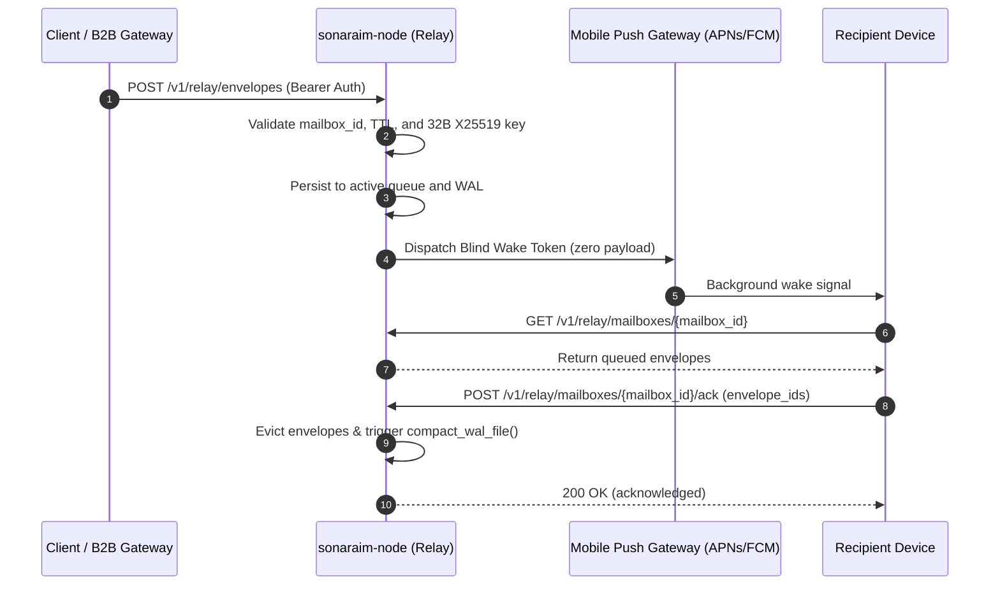
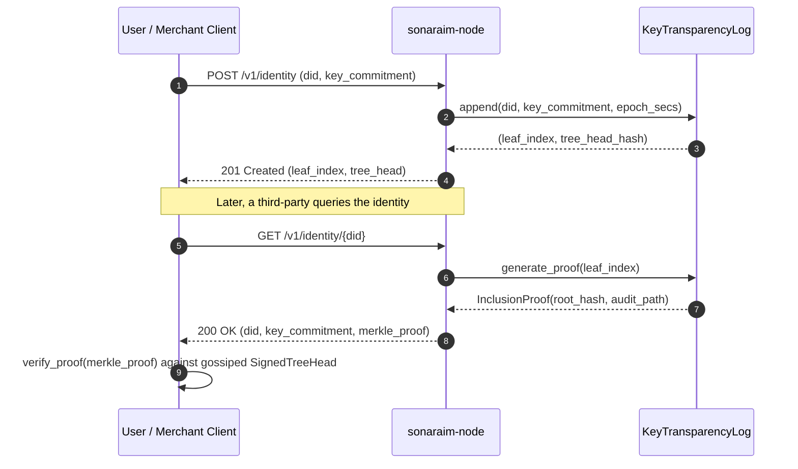
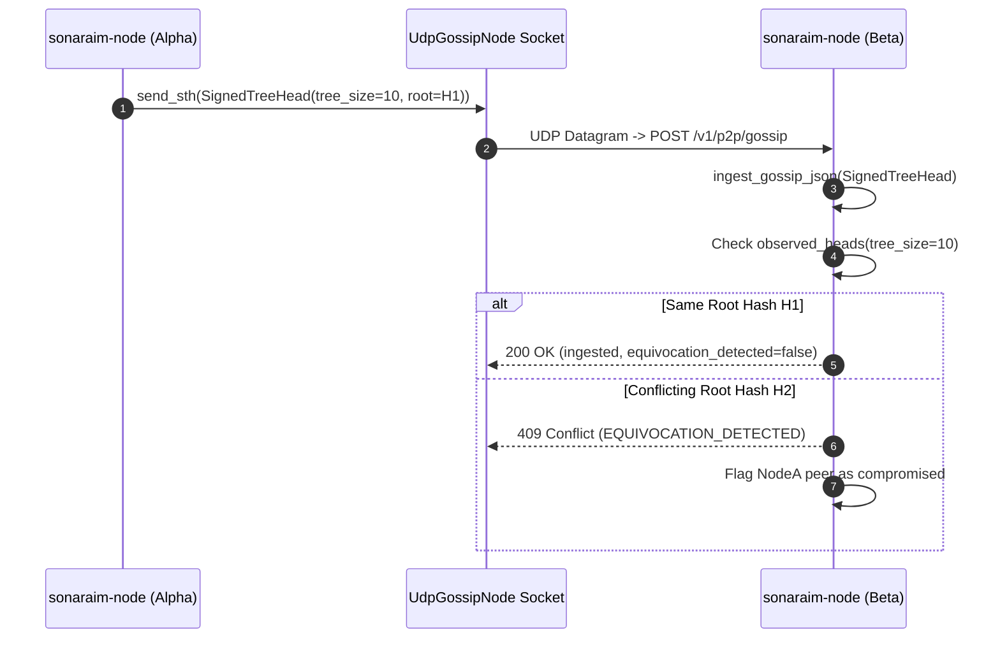
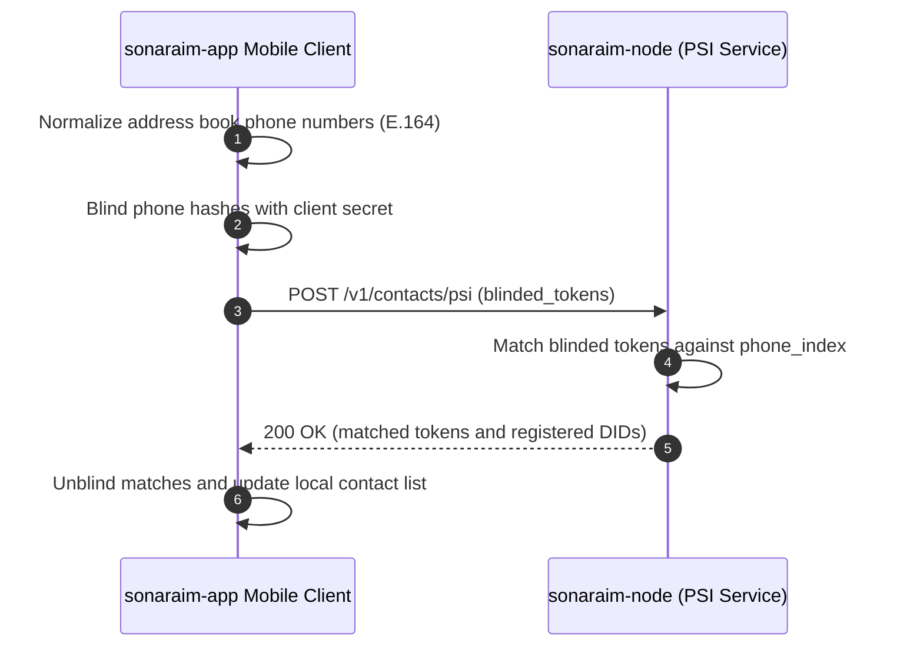
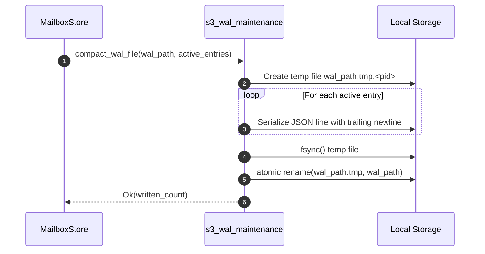

# System Diagrams (`sonaraim-node`)

> Mermaid sequence, topology, and state diagrams for `sonaraim-node`.

---

## 1. Store-and-Forward Envelope Relay Flow

---

## 2. Key Transparency Merkle Append & Proof Verification

---

## 3. Live UDP Gossip & Equivocation Detection

---

## 4. Private Set Intersection (PSI) Matching Flow

---

## 5. Atomic WAL Compaction Sequence

