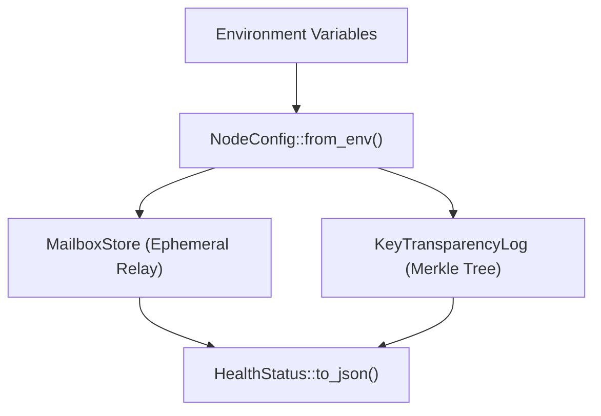
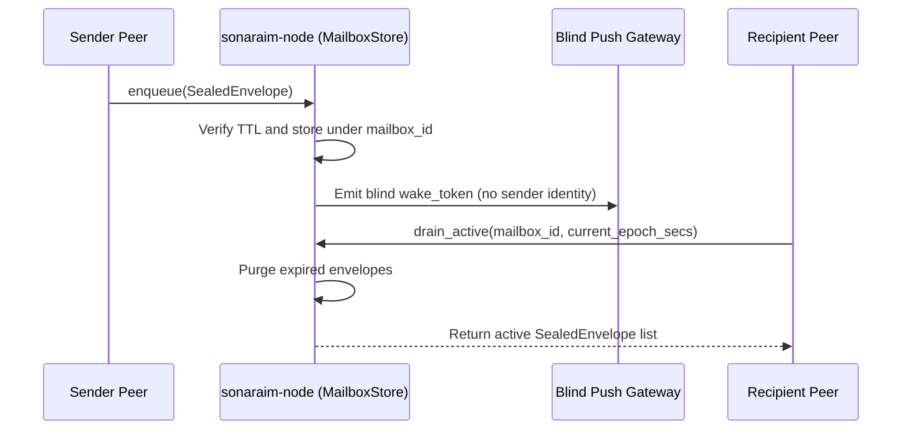
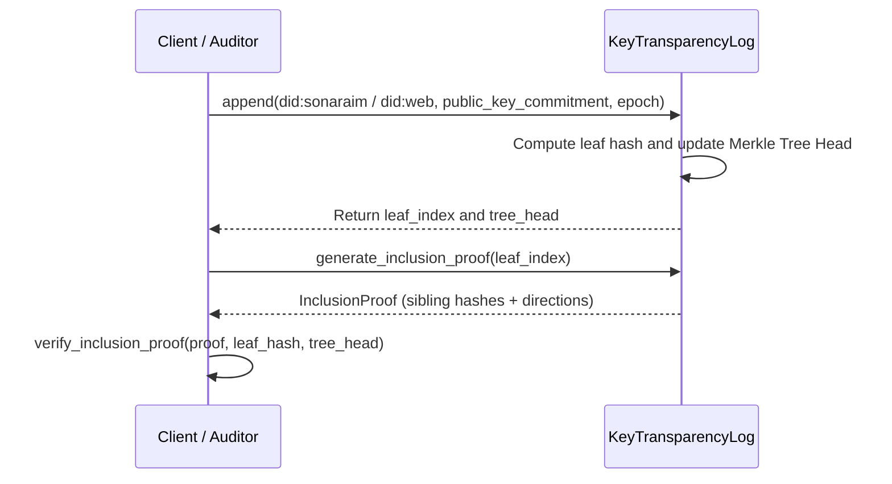

# Architecture Diagrams (`sonaraim-node`)

> Mermaid Component, Sequence, and State Visualizations

## Node Module Topology

## Ephemeral Store-and-Forward Sequence

## Key Transparency Inclusion Proof Flow

